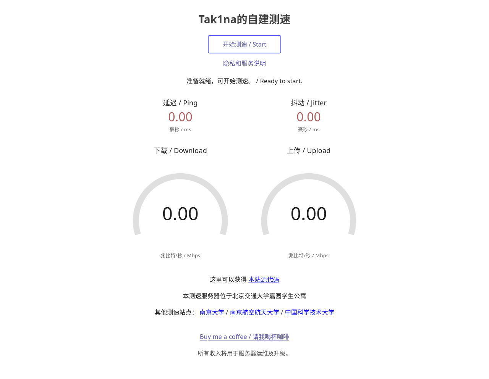
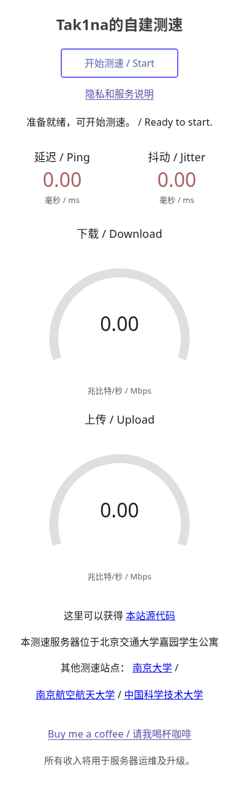
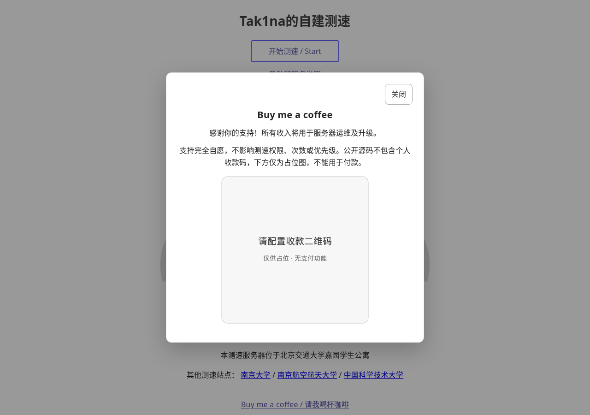

# SpeedTest · v0.1.0

[](https://github.com/Tak1naa/SpeedTest/actions/workflows/checks.yml)
[](https://github.com/Tak1naa/SpeedTest/releases)
[](LICENSE)

English · [简体中文](README.md) · [Contributing](CONTRIBUTING.md) · [Security](SECURITY.md) · [Roadmap](ROADMAP.md)

A bilingual, self-hosted network speed test built on [bg6cq/speedtest](https://github.com/bg6cq/speedtest) / LibreSpeed. It keeps the upstream measurement engine, Worker and endpoint paths, adding a Chinese-facing interface, temporary Redis sessions and bounded transfers.

v0.1.0 is the first standard source release, not a certification that an arbitrary public deployment is secure or can sustain gigabit traffic. The supplied configuration remains loopback-only.

The working tree also contains an [unreleased hardening candidate](HARDENING.md): a bounded HAProxy edge, payload leases, coarse prefix/start windows and fresh image gates. This does not mean v0.1.0 or a production installation has been updated.



<details>
<summary>Mobile interface and support dialog</summary>


</details>

[Screenshot provenance](docs/screenshots/README.md): real public UI, no production data or fabricated speed results.

## Features and limits

- Ping/jitter and ten-second download/upload targets, retaining upstream warm-up and automatic completion.
- Unchanged `/`, `/backend/getIP.php`, `/backend/garbage.php` and `/backend/empty.php`.
- One active test globally; per IP, two starts per rolling five minutes and five per rolling twelve hours. A successful admission counts even if cancelled or interrupted; there is no global daily transfer cap.
- IPv4 /32 and IPv6 /128 buckets. Address rotation, proxies and shared NAT limit the usefulness of IP quotas; these are not identity or DDoS controls.
- Candidate controls add bounded edge requests/connections, in-flight payload slots and wider prefix windows, without sharing the five-per-12h address quota across a campus /64. See [HARDENING.md](HARDENING.md).
- Sixty-second sessions, owner cleanup/TTL recovery, 2.5GB per direction, 100MiB maximum download request and 32MiB upload request, with phase/request deadlines.
- Telemetry, results database/sharing and ISP lookups disabled. Uploads are bounded and discarded; temporary storage is tmpfs, not a promise that PHP never buffers data.
- Accessible native privacy/support dialogs; the public payment image is a **non-payable placeholder**.

Redis is nonpersistent: restarting it clears sessions and quotas. A single valid test can still saturate a shared link.

## Local evaluation

Use a dedicated Linux VM with Docker Engine, Compose, OpenSSL and journald. A starting point is 4 vCPU / 4GB RAM / 16GB disk. Host networking preserves client addresses but is not suitable for copying directly onto a hypervisor or untrusted shared host.

```bash
cp .env.example .env
# Edit .env: set ST_LOG_SALT to the output of openssl rand -hex 32.
mkdir -p tls
openssl req -x509 -newkey rsa:2048 -nodes -days 7 \
  -subj /CN=localhost -addext 'subjectAltName=DNS:localhost,IP:127.0.0.1,IP:::1' \
  -keyout tls/server.key -out tls/server.crt
chmod 600 tls/server.key
# Rootful Docker only: container root has no DAC_OVERRIDE; own the key as root.
# For rootless Docker/Podman keep the calling user's ownership instead.
sudo chown 0:0 tls/server.key
docker compose config -q
docker compose build --pull
docker compose up -d --wait
curl --cacert tls/server.crt https://127.0.0.1:8443/health.php
```

Open `https://127.0.0.1:8443/`. The disposable self-signed certificate is not trusted by browsers by default. Use only an isolated evaluation exception, not a policy of ignoring certificate warnings.

Loopback ports: edge HTTP 8080 / HTTPS 8443, Apache PROXY backend 18080, FPM 19000, Redis 16379. Check for conflicts before starting. Stop only this installation with `docker compose down`.

PHP/Redis/HAProxy bases pin reviewed digests; the PHP build rejects older/untested branches and PECL 6.1.0 verifies its archive digest. Signed APK updates still make rebuilds potentially different; record reviewed base/output identities and fresh scan results.

## Before public exposure

Review network policy, HAProxy listeners/Host/redirect and Apache source/Host checks, trusted TLS and renewal, management isolation, log limits and real-client behavior. Keep Apache PROXY backend, Redis and FPM private; audit VM egress to management networks. Never expose or bypass the plaintext backend. The supplied journald template applies to the whole VM, not just the app.

Do not assume a proxy preserves client identity, forward untrusted client-IP headers, or put measurement traffic behind CDN caching. Scope any load test, set stop thresholds and preserve management access. Read [SECURITY.md](SECURITY.md) for limitations and private vulnerability reporting.

## Tests and contribution

```bash
npm ci --ignore-scripts
npm test
npm run check
```

Offline tests cover Node contracts, upstream hashes, publication guards and real Lua races on a private Unix-socket Redis. Local PHP checks can report SKIP if PHP is absent; CI runs mandatory PHP lint in the pinned runtime, ShellCheck/actionlint, public container build/start, Chromium Worker/cancellation/quota checks and disposable Redis-timeout contracts.

Browser tests need explicit opt-in and consume real test traffic. CI uses a fresh loopback fixture and throttles transport; its numeric results are **not throughput benchmarks**. No Meson is used by this project. See [CONTRIBUTING.md](CONTRIBUTING.md), [validation scope](VALIDATION.md) and the [issue-backed roadmap](ROADMAP.md).

## Attribution and license

Upstream: `bg6cq/speedtest@57e2c9af911d8c392b16b6167249444b7b1107ed`. The two measurement JS files remain byte-identical, verified by `deploy/UPSTREAM_CORE.sha256`. Upstream sources, notices and LGPL-3.0 license are retained. See [UPSTREAM.md](UPSTREAM.md) for adaptation and public-export boundaries.
